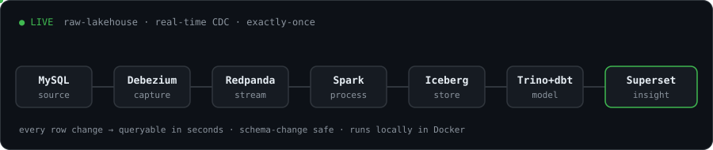

  
  
  

<code>python</code> · <code>sql</code> · <code>postgres</code> · <code>docker</code> · <code>pandas</code> · <code>scikit-learn</code> &nbsp;|&nbsp; learning <code>dbt</code> · <code>airflow</code> · <code>spark</code> · <code>kafka</code> · <code>aws</code>

