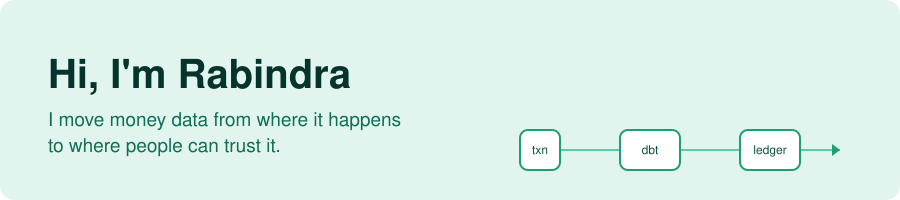
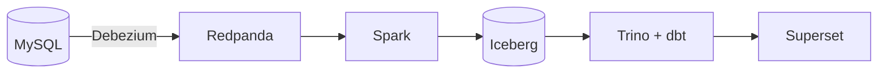

<picture>
  <source media="(prefers-color-scheme: dark)" srcset="banner-dark.svg">
  
</picture>

I'm **Rabindra Bhattarai**, a computing student at Coventry University learning data engineering, with a soft spot for fintech. Apps like eSewa and Khalti handle huge numbers of payments every day, and I want to build the pipelines that make sure every one of them adds up.

### Right now I'm

- Building a daily payments pipeline with Airflow and dbt, including a ledger reconciliation check
- Learning streaming with Kafka and running pipelines on AWS
- Open to junior data engineer and analytics engineer roles

### Featured: [raw-lakehouse](https://github.com/Rabindra-Bhattarai/raw-lakehouse)

Real-time change data capture on e-commerce data. Every change in MySQL lands in a queryable lakehouse within seconds, exactly once, even when the schema changes.

### Other things I've built

- **[fintech-customer-segmentation](https://github.com/Rabindra-Bhattarai/fintech-customer-segmentation)**: groups wallet users by how they pay and flags accounts that look fraudulent
- **[fintech-churn-prediction](https://github.com/Rabindra-Bhattarai/fintech-churn-prediction)**: predicts which bank customers are likely to leave, and suggests how to keep them
- **[Hospital-Intelligent-System](https://github.com/Rabindra-Bhattarai/Hospital-Intelligent-System)**: a dashboard for bed occupancy, patient flow and staff allocation
- **[Ask-My-Docs](https://github.com/Rabindra-Bhattarai/Ask-My-Docs)**: chat with your own PDFs, with the source shown for every answer

### Tools I use

`Python` · `SQL` · `PostgreSQL` · `MySQL` · `Docker` · `pandas` · `scikit-learn` · `Streamlit` · `Power BI` · `Git`

**Learning now:** `dbt` · `Airflow` · `Spark` · `Kafka` · `AWS`

### Say hi

I'm happy to talk about data, fintech, or learning in public. Find me on [LinkedIn](https://www.linkedin.com/in/rabindra-bhattarai-819b35283).
